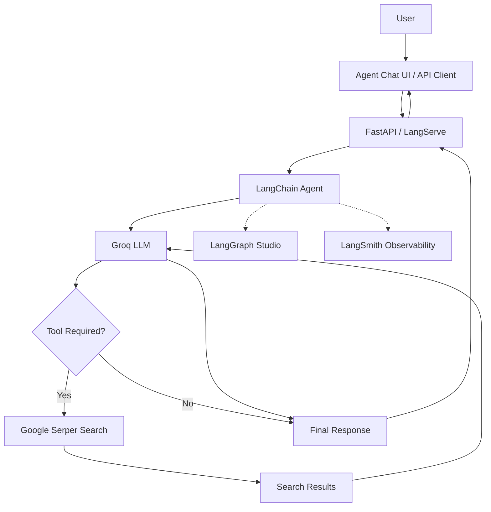

# GenAI Agent — FastAPI, LangChain & LangGraph

A tool-using AI agent built with Python, LangChain, Groq and FastAPI. The project explores how LLMs can interact with external tools, make decisions based on user queries, and deliver responses through API endpoints and a dedicated chat interface.

It also integrates LangGraph Studio and LangSmith to explore agent execution, debugging and observability.

This is a hands-on learning project focused on understanding the fundamentals of building and exposing AI agents using the Python ecosystem.

## Overview

The application uses a Groq-hosted LLM as its reasoning engine and Google Serper as an external web search tool.

Instead of relying entirely on the model's existing knowledge, the agent can decide when a query requires an external search, invoke the appropriate tool, process the returned information and generate a response.

The agent is exposed through FastAPI using LangServe, while LangGraph provides a local development environment for interacting with and inspecting agent executions.

### How It Works

The agent follows a tool-calling workflow:

1. **User Input:** Receives a question through the chat interface or API.
2. **LLM Processing:** The Groq-hosted language model interprets the user's request.
3. **Tool Selection:** The model determines whether an external tool is required.
4. **Tool Execution:** If necessary, the agent invokes Google Serper to retrieve relevant web results.
5. **Response Generation:** The tool output is passed back to the model for processing.
6. **Final Response:** The agent generates and returns a response to the user.

If external information is not required, the model can respond directly without invoking the search tool.

## Architecture



## Tech Stack

| Technology | Purpose |
|---|---|
| Python | Primary programming language |
| FastAPI | Backend API framework |
| Uvicorn | ASGI server |
| LangChain | Agent creation and tool orchestration |
| LangGraph | Agent execution and graph-based workflows |
| LangServe | Exposing the agent through API endpoints |
| Groq | LLM inference provider |
| OpenAI GPT-OSS 120B | Language model used through Groq |
| Google Serper | External web search |
| LangSmith | Tracing, debugging and observability |
| LangGraph Studio | Visualizing and testing agent execution |
| Agent Chat UI | Dedicated conversational interface |
| Pydantic | Data validation and configuration |
| python-dotenv | Environment variable management |

## Key Components

### 1. LLM Integration — Groq

Groq provides the inference infrastructure for the language model.

The project uses `openai/gpt-oss-120b` through the `langchain-groq` integration.

The LLM acts as the agent's reasoning component, interpreting user messages, deciding whether to invoke available tools and generating responses.

### 2. Tool Integration — Google Serper

Google Serper provides web search capabilities through LangChain's `GoogleSerperAPIWrapper`.

The search tool allows the agent to retrieve information from the web when a question requires external or up-to-date information.

Tool selection is handled by the agent rather than requiring every user query to trigger a search.

### 3. Agent Development — LangChain

LangChain is used to create the tool-calling agent through its `create_agent()` interface.

The agent is configured with:

- A Groq language model.
- A system prompt.
- A collection of available tools.

This keeps the agent configuration separate from the API layer.

### 4. API Integration — FastAPI & LangServe

FastAPI provides the application server, while LangServe exposes the agent as API endpoints using `add_routes()`.

The agent is mounted under the `/agent` route, providing endpoints for invoking and streaming agent responses.

### 5. Agent Development & Observability — LangGraph and LangSmith

**LangGraph Studio**

Used as a visual development environment to interact with the agent, inspect its graph and examine execution steps.

**LangSmith**

Provides observability capabilities for tracing agent executions, inspecting model and tool calls, and evaluating agent behavior.

LangSmith cloud tracing requires appropriate API credentials and configuration.

### 6. Conversational Interface — Agent Chat UI

Agent Chat UI provides a dedicated frontend for interacting with the locally running LangGraph Agent Server.

It allows users to submit messages and explore conversational interactions without building a separate frontend from scratch.

## Project Structure

```text
GenAIPractise/
│
├── app/
│   ├── agent/
│   │   ├── agent_prompt.py
│   │   ├── agent_service.py
│   │   └── langgraph_agent.py
│   │
│   ├── api/
│   │   ├── controller/
│   │   │   └── agent_controller.py
│   │   └── route/
│   │       └── agent_router.py
│   │
│   ├── config/
│   │   └── settings.py
│   │
│   ├── llm/
│   │   └── groq_client.py
│   │
│   ├── schema/
│   │   └── agent_schema.py
│   │
│   ├── tool/
│   │   └── web_search.py
│   │
│   ├── util/
│   │   ├── constant.py
│   │   ├── logger.py
│   │   └── notes.txt
│   │
│   └── main.py
│
├── tests/
│
├── langgraph.json
├── requirements.txt
├── README.md
└── LICENSE
```

The structure separates LLM configuration, tool integrations, agent logic and application configuration to keep responsibilities organized.

## Getting Started

### Prerequisites

Make sure you have the following installed:

- Python 3.11 or later (Python 3.14 was used during development).
- Git.
- Node.js and pnpm (for Agent Chat UI).
- A Groq API key.
- A Google Serper API key.

### 1. Clone the Repository

```bash
git clone https://github.com/karkiayush/GenAIPractise.git

cd GenAIPractise
```

### 2. Create a Virtual Environment

```bash
python -m venv .venv
```

Activate it:

**Linux / macOS**

```bash
source .venv/bin/activate
```

**Windows**

```bash
.venv\Scripts\activate
```

### 3. Install Dependencies

```bash
pip install -r requirements.txt
```

### 4. Configure Environment Variables

Create a `.env` file in the project root:

```env
# Groq
GROQ_API_KEY=your_groq_api_key

# Google Serper
SERPER_API_KEY=your_serper_api_key

# LangSmith (Optional)
LANGSMITH_TRACING=true
LANGSMITH_API_KEY=your_langsmith_api_key
```

Replace the placeholder values with your actual API keys.

LangSmith tracing is optional. The local agent development server and Studio can be used without enabling cloud tracing.

Make sure `.env` is included in `.gitignore`. Never commit API keys or other sensitive credentials.

### 5. Run the FastAPI Application

```bash
python -m uvicorn main:app --reload
```

The API will be available at:

```text
http://127.0.0.1:8000
```

### 6. Explore the API

FastAPI Swagger documentation:

```text
http://127.0.0.1:8000/docs
```

LangServe Playground:

```text
http://127.0.0.1:8000/agent/playground/
```

The playground provides an interface to interact with the exposed agent.

### 7. Run the LangGraph Development Server

In a separate terminal, activate the same virtual environment and run:

```bash
langgraph dev
```

The local Agent Server runs at:

```text
http://127.0.0.1:2024
```

LangGraph Studio can be opened through the URL printed in the terminal.

The `langgraph.json` configuration must point to the appropriate agent entrypoint in the project.

### 8. Run Agent Chat UI

Agent Chat UI is maintained separately from this backend repository.

Repository:

https://github.com/langchain-ai/agent-chat-ui

Follow its installation instructions, start the frontend and configure it to connect to:

```text
http://127.0.0.1:2024
```

The frontend provides a conversational interface for interacting with the local agent.

## API Overview

The agent is exposed under the `/agent` prefix using LangServe.

| Endpoint | Method | Description |
|---|---|---|
| `/docs` | GET | FastAPI Swagger documentation |
| `/agent/invoke` | POST | Invoke the agent |
| `/agent/stream` | POST | Stream agent output |
| `/agent/stream_log` | POST | Stream execution logs |
| `/agent/playground/` | GET | LangServe interactive playground |

Additional routes are generated by LangServe. Refer to `/docs` for the actual registered API schema.

## Learning Objectives

This project is part of my journey into Python backend development and AI engineering.

The main concepts explored include:

- Integrating hosted LLMs into Python applications.
- Understanding tool calling and agent execution.
- Building agents with LangChain.
- Integrating external APIs as agent tools.
- Exposing AI agents through REST APIs.
- Understanding streaming responses.
- Exploring LangGraph's graph-based agent architecture.
- Inspecting agent execution using LangGraph Studio.
- Understanding tracing and observability with LangSmith.
- Connecting a dedicated chat frontend to a backend agent.

## Acknowledgements

This project was developed as a hands-on learning exercise while exploring the Python AI ecosystem, particularly LangChain, LangGraph and the integration of LLMs with external tools.

References:

- [LangChain Documentation](https://docs.langchain.com/)
- [LangGraph Documentation](https://docs.langchain.com/oss/python/langgraph/overview)
- [LangSmith Documentation](https://docs.langchain.com/langsmith/home)
- [FastAPI Documentation](https://fastapi.tiangolo.com/)
- [Groq Documentation](https://console.groq.com/docs)
- [Google Serper](https://serper.dev/)
- [Agent Chat UI](https://github.com/langchain-ai/agent-chat-ui)

---

**Author:** [Aayush Karki](https://github.com/karkiayush)

**GitHub:** [github.com/karkiayush](https://github.com/karkiayush)

