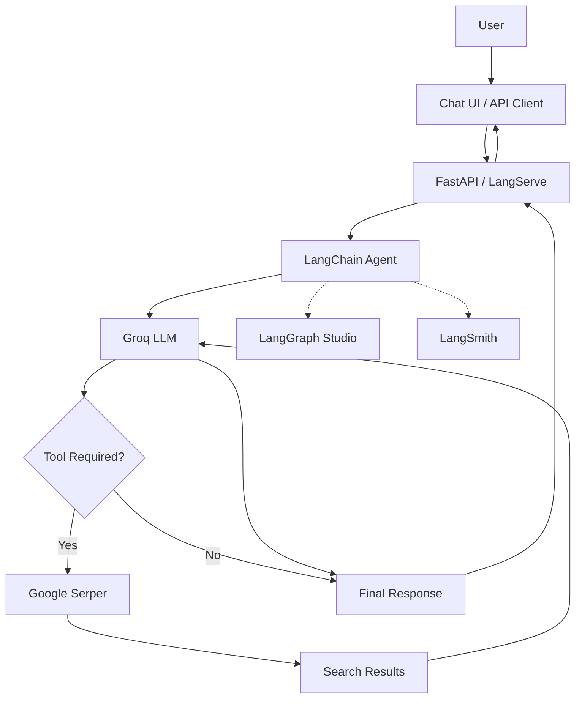

# langchain-groq-chatbot — FastAPI, LangChain & LangGraph

A tool-using AI agent built with Python, LangChain, Groq and FastAPI. It can interact with external tools, decide when web search is needed, and generate responses through API endpoints and a dedicated chat interface.

The project also explores LangGraph Studio and LangSmith for agent development, debugging and observability.

## Overview

The application uses a Groq-hosted LLM (`openai/gpt-oss-120b`) as its reasoning engine and Google Serper for web search.

The agent determines whether a query requires external information. If needed, it invokes Google Serper, processes the results and generates a response. Otherwise, it responds directly using the LLM.

FastAPI and LangServe expose the agent through API endpoints, while LangGraph provides a local development environment for inspecting and testing agent executions.

### How It Works

1. **User Input:** Receives a question through the API or chat interface.
2. **LLM Processing:** Groq processes the user's request.
3. **Tool Selection:** The agent decides whether web search is necessary.
4. **Tool Execution:** Google Serper retrieves relevant information when required.
5. **Response Generation:** The LLM processes the results and generates a response.

## Architecture



## Tech Stack

| Technology | Purpose |
|---|---|
| Python | Primary language |
| FastAPI & Uvicorn | Backend API and ASGI server |
| LangChain | Agent creation and tool orchestration |
| LangGraph | Agent execution and development |
| LangServe | Exposing agent API endpoints |
| Groq (GPT-OSS 120B) | LLM inference |
| Google Serper | Web search |
| LangSmith | Tracing and observability |
| LangGraph Studio | Visual agent development |
| Agent Chat UI | Conversational interface |
| Pydantic & python-dotenv | Validation and configuration |

## Key Components

- **LLM — Groq:** Provides the language model used for reasoning, tool selection and response generation through `langchain-groq`.
- **Web Search — Google Serper:** Integrates web search through LangChain's `GoogleSerperAPIWrapper`.
- **Agent — LangChain:** Creates the tool-using agent using `create_agent()`, a system prompt, an LLM and available tools.
- **API — FastAPI & LangServe:** Exposes the agent under the `/agent` route using `add_routes()`, supporting invocation and streaming.
- **Development & Observability — LangGraph and LangSmith:** LangGraph Studio helps visualize and inspect agent execution, while LangSmith provides tracing and debugging.
- **Chat Interface — Agent Chat UI:** Provides a frontend for interacting with the locally running LangGraph Agent Server.

## Project Structure

```text
GenAIPractise/
├── app/
│   ├── agent/
│   │   ├── agent_prompt.py
│   │   ├── agent_service.py
│   │   └── langgraph_agent.py
│   ├── api/
│   │   ├── controller/
│   │   │   └── agent_controller.py
│   │   └── route/
│   │       └── agent_router.py
│   ├── config/
│   │   └── settings.py
│   ├── llm/
│   │   └── groq_client.py
│   ├── schema/
│   │   └── agent_schema.py
│   ├── tool/
│   │   └── web_search.py
│   ├── util/
│   │   ├── constant.py
│   │   ├── logger.py
│   │   └── notes.txt
│   └── main.py
├── tests/
├── langgraph.json
├── requirements.txt
├── README.md
└── LICENSE
```

The structure separates agent logic, API routes, LLM configuration, tools and application settings.

## Getting Started

### Prerequisites

- Python 3.11+ (developed with Python 3.14)
- Git
- Node.js and pnpm (for Agent Chat UI)
- Groq API key
- Google Serper API key

### 1. Clone the Repository

```bash
git clone https://github.com/karkiayush/GenAIPractise.git
cd GenAIPractise
```

### 2. Create and Activate Virtual Environment

```bash
python -m venv .venv

# Linux / macOS
source .venv/bin/activate

# Windows
.venv\Scripts\activate
```

### 3. Install Dependencies

```bash
pip install -r requirements.txt
```

### 4. Configure Environment Variables

Create a `.env` file in the project root:

```env
GROQ_API_KEY=your_groq_api_key
SERPER_API_KEY=your_serper_api_key

# Optional: LangSmith
LANGSMITH_TRACING=true
LANGSMITH_API_KEY=your_langsmith_api_key
```

Keep your `.env` file in `.gitignore` and never commit API keys.

### 5. Run FastAPI

```bash
python -m uvicorn main:app --reload
```

API: `http://127.0.0.1:8000`

Swagger Docs: `http://127.0.0.1:8000/docs`

LangServe Playground: `http://127.0.0.1:8000/agent/playground/`

### 6. Run LangGraph Development Server

In another terminal:

```bash
langgraph dev
```

The local Agent Server runs at:

`http://127.0.0.1:2024`

Open the Studio URL provided in the terminal to inspect and interact with the agent. Ensure `langgraph.json` points to the correct agent entrypoint.

### 7. Run Agent Chat UI

Agent Chat UI is maintained separately.

Repository: https://github.com/langchain-ai/agent-chat-ui

Follow its installation instructions and configure the frontend to connect to:

`http://127.0.0.1:2024`

## API Endpoints

The agent is exposed under the `/agent` prefix using LangServe.

| Endpoint | Method | Description |
|---|---|---|
| `/docs` | GET | Swagger documentation |
| `/agent/invoke` | POST | Invoke the agent |
| `/agent/stream` | POST | Stream agent responses |
| `/agent/stream_log` | POST | Stream execution logs |
| `/agent/playground/` | GET | LangServe Playground |

Additional endpoints may be generated by LangServe.

## Learning Objectives

This project explores:

- Integrating hosted LLMs into Python applications.
- Building tool-using agents with LangChain.
- Understanding LLM tool selection and execution.
- Exposing agents through FastAPI and LangServe.
- Working with streaming responses.
- Exploring graph-based agent execution with LangGraph.
- Debugging and tracing agents with LangGraph Studio and LangSmith.
- Connecting conversational frontends to backend agents.

## Acknowledgements

Built as a hands-on learning project while exploring the Python AI ecosystem and LLM-powered agent development.

**References:**

- [LangChain](https://docs.langchain.com/)
- [LangGraph](https://docs.langchain.com/oss/python/langgraph/overview)
- [LangSmith](https://docs.langchain.com/langsmith/home)
- [FastAPI](https://fastapi.tiangolo.com/)
- [Groq](https://console.groq.com/docs)
- [Google Serper](https://serper.dev/)
- [Agent Chat UI](https://github.com/langchain-ai/agent-chat-ui)

---

**Author:** [Aayush Karki](https://github.com/karkiayush)

**GitHub:** [github.com/karkiayush](https://github.com/karkiayush)